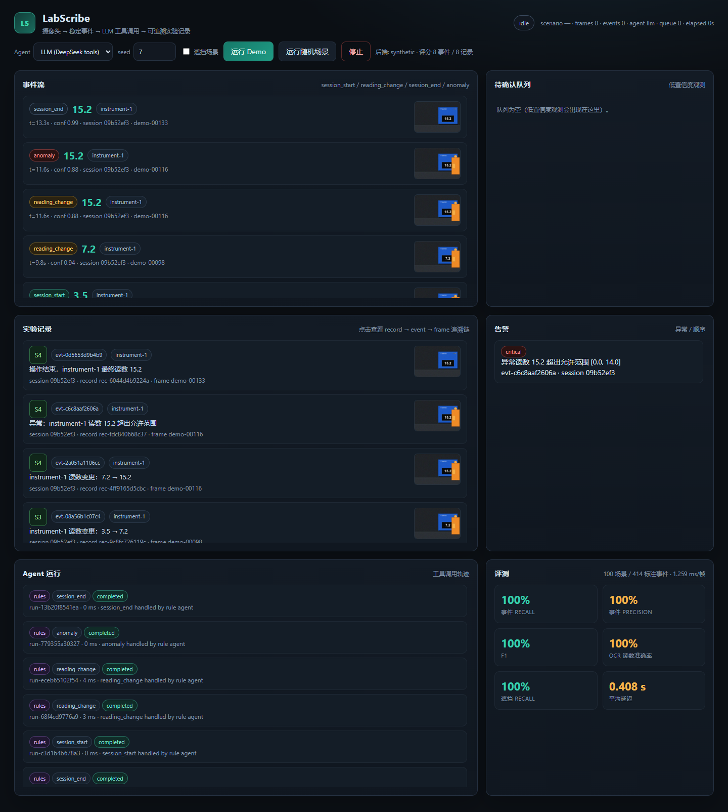
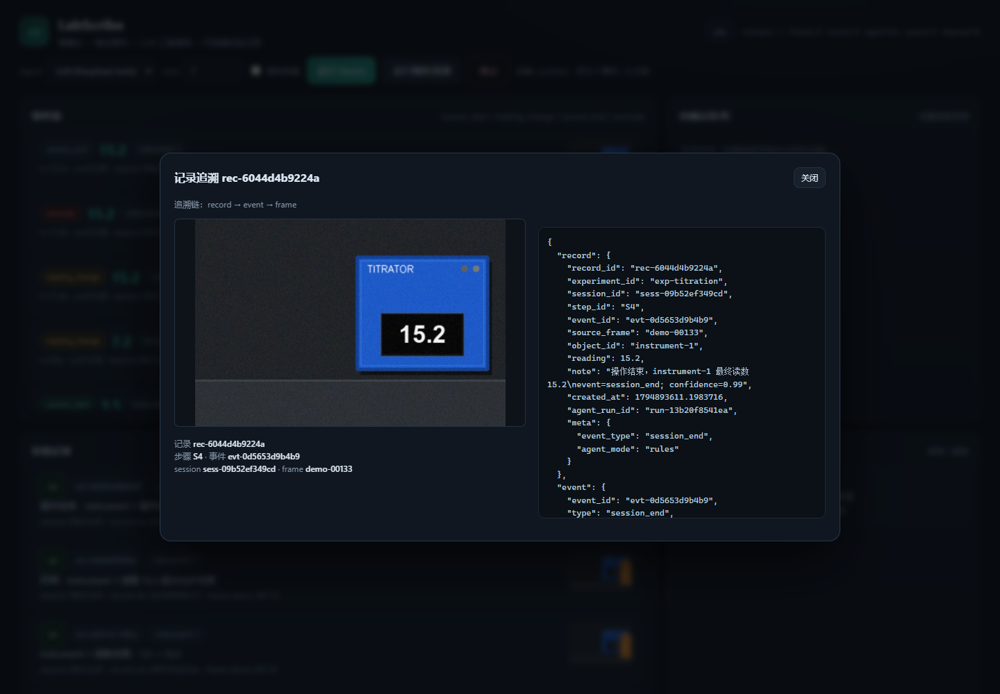

# LabScribe

**实验室操作记录 Agent：视觉 → 事件 → LLM 工具调用 → 可追溯实验记录**

Python 3.12 · YOLO11 · ByteTrack · PaddleOCR · DeepSeek Tool Calling · FastAPI · SQLite

LabScribe 从摄像头画面中识别仪器、操作者与数字显示读数，把连续帧折叠成结构化事件
（开始使用 / 读数变更 / 操作结束 / 异常），再由 LLM Agent 通过工具调用写实验记录、查 SOP、
校验步骤顺序、发异常告警。每条记录都携带 `source_frame` 与 `event_id`，可以从记录一键反查原始画面。

---

## 目录

- [核心能力](#核心能力)
- [架构](#架构)
- [快速开始](#快速开始)
- [API Key 配置](#api-key-配置)
- [CLI](#cli)
- [HTTP API 与 Dashboard](#http-api-与-dashboard)
- [事件与状态机](#事件与状态机)
- [Agent 工具与循环](#agent-工具与循环)
- [可追溯性](#可追溯性)
- [评测](#评测)
- [相关方案调研](#相关方案调研)
- [生产视觉后端](#生产视觉后端)
- [配置](#配置)
- [测试](#测试)
- [项目结构](#项目结构)
- [已知限制](#已知限制)

---

## 核心能力

| 模块 | 实现 |
| --- | --- |
| 视觉 | 仪器 / 人-手检测、稳定 track ID、数字显示区 OCR、按帧率节流、读数稳定化（防抖） |
| 事件 | 统一 `{actor, object, action, reading, confidence, source_frame}`；规则状态机折叠连续帧；低置信度进入待确认队列 |
| Agent | 事件驱动工具调用；SOP 查询、步骤顺序校验、读数范围校验、写记录、推进步骤、异常告警；LLM 循环 + 确定性规划建议 + 规则回退 + 安全补录 |
| 可追溯 | 记录 → 事件 → `source_frame` → JPEG；一帧即可人工复核 |
| 服务 | FastAPI REST + 单页 Dashboard（事件流 / 待确认 / 记录追溯 / 告警 / Agent 轨迹 / 评测） |
| 评测 | 100 个标注场景、414 个标注事件（含 20% 遮挡场景、检测丢失、OCR 空帧），统计事件 P/R/F1、OCR 准确率、端到端延迟、遮挡 recall |

默认开箱即用：无需 GPU、无需摄像头、无需安装 YOLO/Paddle。
内置确定性的合成实验场景 + 离线检测/OCR 后端，一条命令即可跑通「画面 → 事件 → 工具调用 → 记录 → 反查」全链路。
生产环境通过配置切换到 YOLO11 / ByteTrack / PaddleOCR，接口完全一致。

---

## 架构

```text
┌──────────────────────────────── Vision ────────────────────────────────┐
│  Camera / Video / Images / SyntheticScene                              │
│        │                                                               │
│        ▼                                                               │
│  Detector ──► Tracker ──► display ROI ──► throttled OCR ──► Stabilizer │
│  (YOLO11)     (ByteTrack)                 (PaddleOCR)                  │
│               或 offline: marker / IoU / template                      │
└───────────────────────────────────┬────────────────────────────────────┘
                                    │ Observation
                                    │ {actor, object, action, reading, confidence, frame}
┌───────────────────────────────────▼────────────────────────────────────┐
│  RuleStateMachine                                                      │
│  session_start · reading_change · session_end · anomaly                │
│  低置信度 → PendingCandidate（待人工确认队列）                           │
└───────────────────────────────────┬────────────────────────────────────┘
                                    │ LabEvent (+ source_frame, event_id)
┌───────────────────────────────────▼────────────────────────────────────┐
│  Agent loop (DeepSeek / OpenAI-compatible tool calling)                │
│  get_sop_step · validate_step_order · validate_reading                 │
│  write_experiment_record · advance_sop_step · raise_alert               │
│  get_recent_events · get_session_context                               │
│  deterministic planner guidance + rule fallback + safety net           │
└───────────────────────────────────┬────────────────────────────────────┘
                                    │
        ┌───────────────────────────┼────────────────────────────┐
        ▼                           ▼                            ▼
   SQLite: events             SQLite: records             FrameStore
   pending / sessions         agent_runs / steps           frames/*.jpg
        │                           │                            │
        └───────────────────────────┴──────────────► Dashboard / REST / CLI
```

线程模型：视觉线程逐帧处理 → 事件队列 → Agent 工作线程（LLM 延迟不阻塞画面）。
`Runtime.stop()/wait_idle()` 负责优雅收尾；每次运行重建状态机，会话不串场。

---

## 快速开始

```powershell
# 1. 依赖（核心依赖很轻）
python -m pip install -r requirements.txt
# 可选：安装为包，之后可直接使用 `labscribe` 命令
# python -m pip install -e .

# 2. 跑通内置 Demo（规则 Agent，无需 API Key）
python -m labscribe simulate --agent rules

# 3. 真实 LLM 工具调用（需要 DeepSeek key，见下一节）
python -m labscribe simulate --agent llm

# 4. 启动 Dashboard
python -m labscribe serve
#   打开 http://127.0.0.1:8000/ ，点击「运行 Demo」

# 5. 100 场景评测（约 3 分钟）
python -m labscribe eval

# 6. 测试
python -m pytest
```

Demo 时间线（14 秒、10 fps）：

| 时间 | 场景 | 产出事件 |
| --- | --- | --- |
| 1.2–5.6s | 操作员使用滴定仪，读数 0.0 → 3.5 | `session_start` / `reading_change` / `session_end` |
| 7.2–12.2s | 再次操作，7.2 时屏幕被手遮挡，随后出现 15.2 超限读数 | `session_start` / `reading_change`×2 / `anomaly` / `session_end` |
| 全程 | SOP 步骤顺序校验 | S1 → S2 → S3 完成，S4 因超限不推进并告警 |

---

## API Key 配置

项目支持任何 OpenAI-compatible `/chat/completions` 端点。优先级：

1. 环境变量 `LABSCRIBE_LLM_API_KEY`
2. 环境变量 `DEEPSEEK_API_KEY`
3. `.env` 文件（参考 `.env.example`）

```powershell
$env:DEEPSEEK_API_KEY = "sk-..."
$env:DEEPSEEK_BASE_URL = "https://api.deepseek.com"   # 可选
```

> **关于本次提供的 key**：形如 `oc_sk_...` 的 key 在 `https://api.deepseek.com` 上返回
> `HTTP 401 Authentication Fails`，不是该平台的合法 key 格式。代码不会把 key 写死；
> 配置 `LABSCRIBE_LLM_API_KEY` + `DEEPSEEK_BASE_URL` 即可接入你自己的网关。
> 若未配置或请求失败，Agent 会自动回退到确定性的规则 Agent，并在运行记录中明确标注
> `fallback_rules`，不会中断记录流程。

已验证：`deepseek-flash`（DeepSeek-V4.1-Flash，1M context）的 tool calling 可正常驱动 8 个工具完成完整 Demo；
该模型还支持 **图片输入**，可直接对原始帧做 VLM 二次判读（本项目尚未默认启用，见调研文档的 P0 路线）。
`deepseek-v4-pro` 仅支持文本。

---

## CLI

```text
python -m labscribe simulate [--agent llm|rules|off] [--seed N] [--occluded] [--realtime]
python -m labscribe run      [--source camera|video|images] [--camera 0] [--video a.mp4]
                            [--images data/frames_dir] [--max-frames N] [--agent llm]
python -m labscribe serve    [--host 127.0.0.1] [--port 8000] [--agent llm]
python -m labscribe eval     [--limit N] [--dataset path] [--no-report]
python -m labscribe dataset  [--count 100] [--seed 20260101] [--out path]
python -m labscribe trace <record_id>      # record → event → frame 全链路
python -m labscribe pending [--status open]
python -m labscribe stats
```

`simulate` 会打印本次运行的事件、Agent 工具轨迹、实验记录、告警、SOP 进度和最终统计。

---

## HTTP API 与 Dashboard

启动 `python -m labscribe serve` 后打开 `http://127.0.0.1:8000/`。

| 方法 | 路径 | 说明 |
| --- | --- | --- |
| GET | `/api/health` | 健康检查 |
| GET | `/api/status` | 运行时状态、帧数、事件数、Agent 模式、队列 |
| POST | `/api/runtime/start` | `{"scenario":"demo"}` 或 `{"seed":7,"occluded":false,"agent_mode":"llm"}` |
| POST | `/api/runtime/stop` | 停止视觉/Agent 线程 |
| GET | `/api/events` | 事件列表（`limit/since/type/session_id/object_id`） |
| GET | `/api/events/{id}` | 事件 + 原始帧 + 记录 + Agent 运行 + 告警 |
| GET | `/api/frames/{frame_id}` | 原始画面 JPEG |
| GET | `/api/records` | 实验记录列表 |
| GET | `/api/records/{id}/trace` | **追溯链**：record → event → frame |
| GET | `/api/pending` | 低置信度待确认队列 |
| POST | `/api/pending/{id}/confirm` | 人工确认 → 生成事件 → 触发 Agent 补记录 |
| POST | `/api/pending/{id}/reject` | 人工拒绝 |
| GET | `/api/alerts` | 告警列表 |
| GET | `/api/sessions` · `/api/sessions/{id}` | 会话与 SOP 步骤完成情况 |
| GET | `/api/agent/runs` · `/api/agent/runs/{id}` | Agent 运行与逐步工具轨迹 |
| GET | `/api/stats` | 存储统计 |
| GET | `/api/eval/latest` | 最近一次评测报告 JSON |
| POST | `/api/ingest` | 手工注入事件（外部传感器/测试） |

Dashboard 每 1.8s 轮询：事件卡片带缩略图，点击查看事件详情；记录点击查看「记录 → 事件 → 画面」追溯；
待确认队列支持确认/拒绝；Agent 轨迹可展开每个工具的参数、结果与耗时；评测卡片展示最新指标。



记录追溯弹窗：左侧是原始画面（`source_frame`），右侧是记录与事件 JSON，人工复核只需看一帧：



---

## 事件与状态机

统一事件结构（`labscribe/schema.py::LabEvent`）：

```json
{
  "event_id": "evt-...",
  "type": "reading_change",
  "ts": 9.8,
  "object_id": "instrument-1",
  "object_label": "instrument",
  "actor_id": "actor-3",
  "action": "interacting",
  "reading": 7.2,
  "confidence": 0.94,
  "source_frame": "demo-00098",
  "session_id": "sess-...",
  "status": "confirmed",
  "meta": {"previous_reading": 3.5, "occluded": false, "machine": "rule"}
}
```

规则（`events/state_machine.py`，阈值均在 `configs/default.yaml`）：

| 事件 | 触发条件 |
| --- | --- |
| `session_start` | 同一仪器连续 `session_start_frames` 帧检测到操作者 |
| `reading_change` | 稳定读数与上次稳定读数相差 > `reading_tolerance`；每次跃变只发一次 |
| `session_end` | 操作者离开超过 `session_end_idle_s` 秒 |
| `anomaly` | 稳定读数超出 `events.limits` 的 `[min,max]`；同一超限值不重复告警 |

**读数稳定性**：OCR 按 `ocr_every_n_frames` 节流；最近 `stable_samples` 个样本极差在
`tolerance_abs + tolerance_rel*|value|` 内才认定为稳定值。抖动不会写入记录；
遮挡/空帧不会伪造读数。连续缺帧超过 `max_gap_s` 时重新建立基线。

**低置信度**：置信度 = `min(detection_conf, reading_conf)`。低于 `events.min_confidence` 时：
* 不改变状态机状态；
* 生成 `PendingCandidate`（含候选事件类型、读数、帧、原因）；
* 相同对象/类型的候选在 `pending_coalesce_s` 内合并；
* 人工在 Dashboard 确认后，事件以 `human_confirmed` 状态落库，并继续交给 Agent 写记录。

---

## Agent 工具与循环

| 工具 | 作用 |
| --- | --- |
| `get_sop_step` | 按 id 或 `next` 查询 SOP 步骤、已完成步骤、下一步 |
| `validate_step_order` | 校验步骤是否可按顺序执行；越序返回 `allowed=false` |
| `validate_reading` | 将读数与步骤 `expected_reading` 范围比较 |
| `write_experiment_record` | 写结构化记录；自动继承事件的 `source_frame`；同事件+步骤幂等 |
| `advance_sop_step` | 标记步骤完成；越序拒绝；SOP 进度按实验持久化（跨视觉会话） |
| `raise_alert` | info / warning / critical 告警，关联事件与会话 |
| `get_recent_events` | 最近事件上下文 |
| `get_session_context` | 会话、已完成步骤、最近事件/记录、下一步 |

LLM 循环（`agent/loop.py`）：

1. 构造 system prompt（角色 + SOP + 硬约束）与 user prompt（事件 + 会话上下文 + **确定性规划建议**）；
2. 调用 `deepseek-flash`（或任意兼容端点），可连续多轮 tool calls；
3. 每个工具调用/结果/耗时写入 `agent_steps`，可完整回放；
4. 达到 `max_steps` 或模型给出最终答复即结束；
5. **规划建议**由同一套确定性规则生成（当前步骤、读数范围检查、建议的 validate/write/advance/alert 顺序），
   防止 LLM 过度保守导致 SOP 流程停滞；最终是否调用、如何措辞仍由模型决定；
6. **安全网**：若模型没有写记录，仍自动补一条可追溯记录；anomaly 没有告警则自动补 critical 告警；
7. LLM 不可用时（无 key / 超时 / 4xx/5xx）按 `agent.fallback_to_rules` 回退到规则 Agent，
   状态标为 `fallback_rules`。

规则 Agent 的确定性流程：session_start → 记录当前步骤；reading_change → 校验范围 → 记录 →
在范围内（或无范围要求）推进步骤，超范围告警不推进；session_end → 记录 → 无读数要求的步骤收尾推进；
anomaly → critical 告警 + 记录。

---

## 可追溯性

```text
ExperimentRecord.record_id
        │ event_id
        ▼
LabEvent { ... source_frame: "demo-00098" }
        │
        ▼
FrameStore.persist(source_frame) → data/frames/demo-00098.jpg
        │
        ▼
GET /api/records/{record_id}/trace  →  {record, event, frame{url}, agent_runs, trace_chain}
```

* 只持久化被事件/待确认项引用的帧（内存环形缓冲，默认 240 帧），避免 7×24 摄像头写满磁盘；
* 记录写入时由服务端根据 `event_id` 反查 `source_frame`，**模型无法伪造帧 ID**；
* CLI `python -m labscribe trace <record_id>` 可直接打印整条链和帧文件路径。

---

## 评测

数据集：`data/eval/annotations.jsonl`（`labsynthetic-events-v1`）

* **100 个标注场景**，共 **414 个标注事件**：136 `session_start` / 136 `session_end` / 128 `reading_change` / 14 `anomaly`
* 20 个场景（20%）在读数变更期间用手遮挡显示区
* 随机注入检测丢失帧（2–4 帧）与显示空帧（OCR dropout）
* 每条标注包含事件类型、发生时刻、允许匹配窗口、期望读数、是否遮挡

评测口径：

* **事件匹配**：同类型、预测时刻落入标注窗口，贪心一对一；类型/对象不匹配或窗口外计 FP/FN；
* **事件触发准确率**：`recall = TP / GT`，同时报告 precision / F1；
* **OCR 读数准确率**：稳定读数与标注读数绝对误差 ≤ 0.15；另报原始 OCR 逐样本/可见帧准确率；
* **端到端延迟**：预测事件时刻 − 物理事件锚点（模拟时钟，秒），报告 mean/p95；
* **遮挡漏检**：独立统计遮挡事件 recall。

当前结果（`reports/eval_report.md`，离线后端 `marker/iou/template`，10 fps，11,809 帧）：

| 指标 | 结果 |
| --- | --- |
| 事件 precision / recall / F1 | **100% / 100% / 100%**（414/414） |
| `reading_change` | 128/128，平均延迟 0.92s，p95 1.58s |
| `session_start` | 136/136，平均延迟 0.26s |
| `session_end` | 136/136，平均延迟 0.02s |
| `anomaly` | 14/14，平均延迟 0.97s |
| 事件读数准确率 | **100%**（142 个读数） |
| 可见帧 OCR 准确率 | **100%**（3,709 帧） |
| 遮挡 recall | **100%**（23/23） |
| 帧处理耗时 | **1.26 ms/帧**（CPU） |

> 诚实说明：该基准使用与渲染器同源的离线检测/OCR 后端，是为了让事件层、状态机与评测可复现，
> **不代表真实摄像头上的模型精度**。生产环境应安装 YOLO11 + ByteTrack + PaddleOCR，并在真实
> 标注数据上重新评测；`eval` 会记录所用后端（`system.detector/tracker/ocr`）。

---

## 相关方案调研

完整快照与链接见 [`docs/related-work.md`](docs/related-work.md)。最接近的项目与差异：

| 项目 | 最接近的部分 | 与本项目的差异 |
| --- | --- | --- |
| [MannLabs/proteomics_lab_agent](https://github.com/MannLabs/proteomics_lab_agent) | 多模态实验室 Agent、MCP 工具、从视频生成协议 | 面向蛋白质组学知识/仪器 QC，无实时事件流与帧级追溯 |
| [NVIDIA/sop-monitoring-blueprints](https://github.com/NVIDIA/sop-monitoring-blueprints) | VLM + 时序分割做 SOP 监控 | 重模型微调/DeepStream，不做逐事件工具调用与实验记录 |
| [KRATSZ/LabScript-AI](https://github.com/KRATSZ/LabScript-AI) | Agent + 运行时感知 + allow/ask/suspend 安全门禁 | 面向移液机器人执行与恢复，不做 SOP 记录与审计 |
| [zbbio/lab-robot](https://github.com/zbbio/lab-robot) | MCP 相机 + 云端 VLM 问答 + Opentrons | 无事件折叠、稳定读数、待确认队列与评测 |
| [zaixizhang/LabOS](https://github.com/zaixizhang/LabOS) | 多 Agent、98 工具、多模态感知/XR | 干实验 Co-Scientist，不覆盖摄像头事件流 |
| [ChemCrow](https://github.com/ur-whitelab/chemcrow-public) / [Coscientist](https://github.com/gomesgroup/coscientist) | LLM 工具调用驱动化学实验 | 无视觉、仪器读数与可追溯记录 |

结论：各段都有成熟方案，但**「稳定读数 → 离散事件 → 工具调用 → 帧级追溯 + 可复现评测」的闭环**未发现完全相同的开源实现。
优先建议：用 Flash 的图片能力做低置信度帧的 VLM 二次判读、把相机/事件/记录 MCP 化、给记录标注证据等级并对接 ELN。

---

## 生产视觉后端

```powershell
python -m pip install -r requirements-vision.txt
```

```yaml
# configs/default.yaml
vision:
  detector: yolo11
  detector_model: weights/lab_instruments.pt
  tracker: bytetrack
  ocr: paddle
  class_map:
    person: actor
    titrator: instrument
    spectrophotometer: instrument
  object_id_map: {}            # 生产环境用 track id：instrument-<track_id>
```

* **YOLO11**：`ultralytics` 加载权重；`vision.class_map` 将模型类别映射为 `actor` / `instrument`，
  未映射类别被忽略；仪器检测框按 `display_roi` 比例裁剪出数字显示区；
* **ByteTrack**：通过 `supervision.ByteTrack` 适配，保持稳定 `track_id`；
* **PaddleOCR**：懒加载，对显示区裁剪图做识别，正则提取数值；
* 任一重依赖缺失时 `auto` 模式自动回退到离线后端并记录 warning，服务不会挂；
* 真实场景建议：仪器显示区标定（`display_roi` 可按 object_id 配置）、镜头固定、显示区补光；
  多人场景可扩展 `actor` 与仪器的分配策略（当前取重叠面积最大的操作者）。

---

## 配置

主配置：`configs/default.yaml`，支持环境变量覆盖：

| 环境变量 | 对应配置 |
| --- | --- |
| `LABSCRIBE_LLM_API_KEY` / `DEEPSEEK_API_KEY` | Agent key（不落盘） |
| `DEEPSEEK_BASE_URL` / `LABSCRIBE_LLM_BASE_URL` | `agent.base_url` |
| `LABSCRIBE_LLM_MODEL` | `agent.model` |
| `LABSCRIBE_AGENT_MODE` | `agent.mode`（llm/rules/off） |
| `LABSCRIBE_DB_PATH` / `LABSCRIBE_FRAMES_DIR` | 存储位置 |
| `LABSCRIBE_VISION_SOURCE` | synthetic/camera/video/images |
| `LABSCRIBE_EXPERIMENT_ID` | 当前实验与 SOP |

关键阈值：

```yaml
vision:
  ocr_every_n_frames: 3        # OCR 节流
  reading: { stable_samples: 3, tolerance_abs: 0.25, tolerance_rel: 0.01, max_gap_s: 2.0 }
  display_occlusion_ratio: 0.30
events:
  min_confidence: 0.55
  session_start_frames: 3
  session_end_idle_s: 1.2
  reading_tolerance: 0.4
  limits: { instrument-1: { min: 0.0, max: 14.0 } }
agent:
  model: deepseek-flash
  max_steps: 8
  fallback_to_rules: true
```

SOP 文件位于 `data/sop/*.yaml`，包含步骤、仪器、指令与期望读数范围；`agent.experiment_id` 选择当前 SOP。

---

## 测试

```text
46 passed
```

覆盖：

* 读数稳定器（防抖、跃变只发一次、缺帧重置）
* 状态机（会话开始/结束、读数变更去重、异常、低置信度 pending、确认后状态推进）
* 工具层（步骤顺序、越序拒绝、读数范围、记录幂等、`source_frame` 追溯、告警关联）
* 视觉链路（模板 OCR 多读数、遮挡无读数、检测角色、track ID 稳定、稳定读数输出）
* Agent（规则流程、异常告警、LLM 失败回退、安全补录、规划建议）
* LLM 客户端（tool call 解析、非法参数、MockTransport 请求/鉴权）
* API（启动/事件/记录/帧/追溯/会话/统计/手工注入/pending 确认触发 Agent）
* 评测（100 条数据集契约、生成确定性、3 场景 smoke）
* 运行时（完整 Demo 8 事件 / 8 记录 / 1 告警 / S1–S3 完成 / 全部帧可反查；连续运行不串会话）

---

## 项目结构

```text
labscribe/
  schema.py              # BBox / Detection / Frame / Observation / LabEvent / SOP / Record
  config.py              # YAML + .env + 环境变量覆盖
  sop.py                 # SOP 注册表
  runtime.py             # 视觉线程 + Agent 工作线程 + 生命周期
  cli.py                 # simulate / run / serve / eval / trace / pending / stats
  vision/
    synthetic.py         # 确定性实验场景渲染（仪器、手、读数、遮挡、丢帧）
    detector.py          # MarkerDetector / Yolo11Detector / 工厂
    tracker.py           # IoUTracker / ByteTrackTracker / 工厂
    ocr.py               # TemplateOCR / PaddleOCRBackend / 工厂
    stability.py         # 读数稳定化
    pipeline.py          # 检测→跟踪→OCR 节流→Observation
    frame_source.py      # camera / video / images / synthetic
  events/
    state_machine.py     # 规则状态机 + pending 候选
    processor.py         # 落库、帧持久化、会话、pending 确认
    bus.py               # 进程内事件总线
  agent/
    llm.py               # OpenAI-compatible client + tool call 解析 + 重试
    tools.py             # 8 个工具 + JSON Schema
    loop.py              # LLM 循环 / 规划建议 / 规则回退 / 安全网
  store/
    db.py                # SQLite（events/pending/records/alerts/runs/steps/sessions）
    frames.py            # 内存环形缓冲 + 按需 JPEG 持久化
  eval/
    dataset.py           # 100 场景标注集生成/加载
    harness.py           # 匹配、指标、遮挡子集、报告
  api/
    app.py               # FastAPI
    static/index.html    # Dashboard
configs/default.yaml
data/sop/*.yaml
data/eval/annotations.jsonl
reports/eval_report.{json,md}
tests/
```

---

## 已知限制

1. **真实精度需重新评测**：离线后端与合成渲染同源，100% 指标验证的是事件/状态机/追溯逻辑；
   真实摄像头请用生产后端 + 真实标注重跑 `labscribe eval`。
2. **多人场景**：操作者分配目前按与仪器区域重叠面积最大者，多人同时操作需扩展身份绑定。
3. **显示区依赖标定**：`display_roi` 为仪器框的固定比例；不同型号/机位需要标定或改为检测显示区。
4. **遮挡判定基于 bbox 覆盖率**，不做像素级分割；强反光/透明遮挡可能漏判。
5. **SQLite 单机存储**：视频帧落盘 + WAL，适合单机部署；高并发/多摄像头建议换 PostgreSQL + 对象存储。
6. **LLM 延迟/成本**：每个事件一次或多次 chat completion（Demo 中 8 事件约 20–30s）；
   规则回退可保证生产连续性，但不会生成自由文本总结。
7. **无真实摄像头输入**：本环境未接入摄像头；`camera/video/images` 数据源已实现，
   `python -m labscribe run --source camera` 可直接验证。
