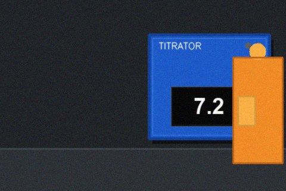
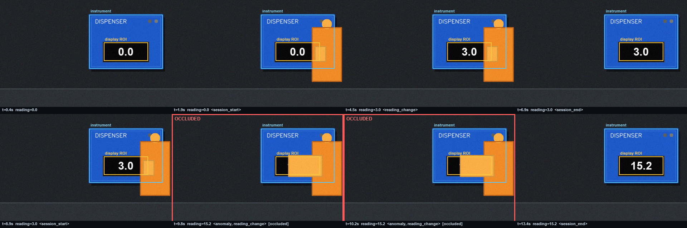

# LabScribe 原理与链路详解

> 面向想真正理解这个项目的人：先讲清楚**为什么这么设计**，再看**关键代码**，最后用**真实运行数据**走完一遍。
> 文中代码均来自当前仓库，可以对照 `labscribe/` 下同名文件阅读。

---

## 0. 一分钟速览

LabScribe 做一件事：**把摄像头里的"人在用仪器做实验"自动变成可以审计的实验日志。**

三个数字概括它：

| 数字 | 含义 |
| --- | --- |
| **1 帧** | 人工复核一条记录只需要看 1 张原始画面 |
| **4 类事件** | `session_start` / `reading_change` / `session_end` / `anomaly` |
| **8 个工具** | LLM 能调用的确定性动作，所有副作用都要经过它们 |

它不训练自己的视觉模型，也不让 LLM 直接看视频。整条链路是：

```text
画面 → 检测/跟踪 → OCR 读数 → 稳定化 → 规则状态机 → 事件 → LLM 工具调用 → 记录/告警/SOP
```

**阅读说明**：这是一份端到端的原理文档，不需要事先了解 CV 或 LLM。
第 3–7 节按数据流逐层拆解（代码 + 类比），第 8 节用一个真实事件串起全链路，
第 9 节讲数据集与评测（含训练集/测试集概念），第 10 节讲生产环境如何获得可信的真实数据，
第 11 节是常见疑问，文末附**面试重点**（按「AI Agent 工程实习生」JD 逐条对照）。每节都可独立阅读，卡住时可以先跳到第 8 节看全景。

常用术语速查（完整版见文末术语表）：

| 术语 | 一句话 |
| --- | --- |
| **帧 Frame** | 视频里的一张图 + 时间戳 |
| **检测 Detection** | 图上框出的"这是仪器/这是人"，带置信度 |
| **跟踪 Track** | 给同一个目标在连续帧里保持同一个 ID |
| **OCR** | 把显示区的画面识别成数字 |
| **稳定化** | 连续几次读数一致才认为可信，防抖 |
| **观测 Observation** | 单帧对单台仪器的汇总（有人吗？读数多少？稳吗？挡了吗？） |
| **事件 Event** | 有开始/结束语义的离散事实，如"读数从 3.5 变成 7.2" |
| **SOP** | 标准操作流程，有序步骤 + 每步期望读数 |
| **工具调用 Tool call** | LLM 请求执行一个确定性函数（写记录、查 SOP、告警） |
| **追溯 Traceability** | 每条记录都能反查回产生它的原始画面 |
| **测试集 Test set** | 从不参与调参、只用于最终报数的数据 |

---

## 1. 一句话原理与贯穿全文的类比

> **类比：实验室里有一位"不眨眼的实习生"和一个"只按规矩办事的书记员"。**
>
> - **实习生（视觉层）** 盯着仪器屏幕，但他不是每看一眼就汇报——他要**连续几次看到同一个数字**才敢记下来；
> - **记录员（事件层）** 把实习生的碎碎念剪成"开始干活了 / 数变了 / 干完了 / 出事了"四类**镜头**；
> - **书记员（Agent）** 拿着 SOP 手册，检查"第几步了、读数对不对、该写哪一栏"，然后**用笔写进台账**；
> - **档案室（存储层）** 每一条台账都**钉着当时的照片**，任何一条都能翻回原始那一帧；
> - 如果书记员请假（LLM 超时/没 key），有**代理书记员**按同样的模板把台账写完，绝不会漏页。

这个类比对应到代码里的五层，后面每层都会展开。

| 类比角色 | 对应模块 | 职责 |
| --- | --- | --- |
| 实习生 | `labscribe/vision/` | 检测、跟踪、OCR、读数稳定 |
| 记录员 | `labscribe/events/` | 连续帧 → 离散事件 |
| 传送带 | `labscribe/runtime.py` | 视觉线程 → 队列 → Agent 线程 |
| 书记员 | `labscribe/agent/` | LLM + 工具调用 + 规则回退 |
| 档案室 | `labscribe/store/` | SQLite + 原始帧 + 追溯 |

---

## 2. 全局链路图

```text
┌──────────────────────────── ① 视觉层（每个视频帧） ────────────────────────────┐
│                                                                              │
│  Frame ──► Detector ──► Tracker ──► 选出 instrument + 最近的 actor            │
│             YOLO11      ByteTrack       │                                     │
│                                         ▼                                     │
│                              显示区被遮挡？── 是 ──► 不 OCR（不伪造读数）      │
│                                         │ 否                                  │
│                                         ▼                                     │
│                            每 N 帧节流一次 OCR（PaddleOCR / 模板）             │
│                                         │                                     │
│                                         ▼                                     │
│                          ReadingStabilizer（连续 3 次一致才算数）              │
└──────────────────────────────────────────┬───────────────────────────────────┘
                                           │ Observation
                                           │ {actor, object, action, reading,
                                           │  confidence, frame_id, occluded}
┌──────────────────────────────────────────▼───────────────────────────────────┐
│ ② 事件层 RuleStateMachine（每个观测）                                          │
│                                                                              │
│   session_start（连续 N 帧有人）   reading_change（稳定值与上次差 > 容差）      │
│   session_end（人离开 > 1.2s）     anomaly（读数超出 [min,max]）               │
│                                                                              │
│   置信度 < 0.55 ──► 不改状态，进 PendingCandidate（待人工确认）                │
└──────────────────────────────────────────┬───────────────────────────────────┘
                                           │ LabEvent（带 event_id + source_frame）
                                           ▼
                                    queue.Queue  ← 视觉线程只放不取，不阻塞
                                           │
┌──────────────────────────────────────────▼───────────────────────────────────┐
│ ③ Agent 层 LabAgent（每个事件一次完整回合）                                    │
│                                                                              │
│   system: 角色 + SOP + 硬规则                                                │
│   user:   事件 JSON + 会话上下文 + 确定性规划建议                              │
│                    │                                                         │
│                    ▼                                                         │
│   deepseek-flash ⇄ 8 个工具（校验/写记录/推进步骤/告警）                       │
│                    │                                                         │
│   每个工具调用 → agent_steps 表（参数、返回值、耗时，可回放）                   │
│   LLM 失败 → 规则 Agent；模型漏写 → 安全网补写                                 │
└──────────────────────────────────────────┬───────────────────────────────────┘
                                           │
              ┌────────────────────────────┼────────────────────────────┐
              ▼                            ▼                            ▼
        records（台账）               alerts（告警）               frames/*.jpg
        带 event_id                 关联 event_id               按需落盘
              │                            │                            │
              └────────────► 追溯：record → event → source_frame ◄──────┘
```

关键点：**视觉线程和 Agent 线程解耦**。LLM 一次要 2–4 秒，画面不能停；所以视觉侧只管往队列里丢事件，Agent 侧慢慢处理。Demo 里 140 帧只处理了约 1.4 秒（不含 LLM），8 个事件全部正确入队。

两条循环的骨架只有三行：视觉线程 `agent_queue.put(event)`，Agent 线程 `agent_queue.get()`，结束时放一个 `None` 作为收尾信号。

---

## 3. 第 1 层：视觉层 —— 从像素到"可信读数"

### 3.1 为什么不能每帧都信

> **类比：看温度计。** 你瞥一眼是 36.5，再看一眼是 36.8，第三眼又回到 36.5。你不会立刻把三个数都记进实验记录——你会等它**稳定**。

如果直接把每帧 OCR 结果写进记录，会出现三类垃圾数据：

1. **抖动**：数字 7.2 / 7.3 / 7.2 来回跳，无法判断真实值；
2. **遮挡**：手挡住半个屏幕，OCR 把 "1" 读成 "7"；
3. **空帧**：显示区被完全遮住，OCR 返回垃圾或空串。

所以视觉层做四件事：检测 → 跟踪 → 节流 OCR → 稳定化。

### 3.2 检测与跟踪：谁在看哪台仪器

视觉层的主循环只有三步：`detector.detect(frame)` 拿到检测框 → `tracker.update(...)` 给每个目标贴上稳定 ID → 按角色分成 `actor` 人和 `instrument` 仪器，逐个生成观测。

- `Detector`：生产环境是 YOLO11，离线是 `MarkerDetector`（颜色标记）。角色只有两种：`actor`（人/手）和 `instrument`（仪器）。分类映射在 `vision.class_map`。
- `Tracker`：生产环境 ByteTrack，离线是 IoU 跟踪器。它保证同一台仪器在连续帧里拿到**稳定的 track_id**，不会一会 `instrument-1` 一会 `instrument-2`。
- `object_id`：配置里可以把类别映射成固定 ID（`instrument-1`），生产环境可用 track id 区分多台同类仪器。

> **类比：跟踪就像给每个"演员"贴胸牌。** 帧与帧之间演员会移动，但胸牌号不变，这样"读数变化"才能归到同一个对象名下。

### 3.3 显示区裁剪 + OCR 节流 + 遮挡

每个观测做四件事，顺序很重要：**先判遮挡 → 再决定要不要 OCR → 只裁显示区 → 节流**。

1. **只裁显示区**：整帧 OCR 又慢又容易读到标签文字（TITRATOR）。显示区按仪器框的固定比例裁剪（`vision.display_roi = [0.20, 0.52, 0.80, 0.86]`）。
2. **按帧节流**：`ocr_every_n_frames=3`，10 fps 下每 0.3 秒读一次。OCR 是整条视觉链路最贵的一步。
3. **遮挡 ≠ 0**：手挡住时传 `None`，而不是 `0.0`。这很重要——如果传 0，状态机会认为"读数变成 0 了"，写出一条假记录。传 `None` 表示"这一帧没有可信观测"。
4. **遮挡判定**：人框覆盖显示区 ≥ 30% 就不读，不做"猜一个"。

> **类比：实习生被手挡住时会说"没看清"，而不是"我看到 0"。**

### 3.4 读数稳定器（本项目最巧的一小段代码）

这是全项目最值得看的一段代码，因为它决定了"什么才算一个可信的事实"。

```python
# labscribe/vision/stability.py（核心逻辑，已省略 dataclass 样板）
def update(self, ts, value, confidence=1.0) -> StableReading:
    # 1. 断档太久：旧基线作废
    if self._last_ts is not None and ts - self._last_ts > self.max_gap_s:
        self._samples.clear()
        self._last_stable = None
    self._last_ts = ts

    # 2. 空帧/遮挡：保留旧值，但标记"不新鲜"
    if value is None or confidence <= 0:
        return StableReading(self._last_stable, stable=False, changed=False)

    self._samples.append((ts, value, confidence))
    if len(self._samples) < self.stable_samples:
        return StableReading(..., stable=False)

    # 3. 最近 N 个样本是否一致（相对容差，随量程放大）
    values = [s[1] for s in self._samples[-self.stable_samples:]]
    mean = sum(values) / len(values)
    tolerance = self.tolerance_abs + self.tolerance_rel * abs(mean)
    if max(values) - min(values) > tolerance:
        return StableReading(..., stable=False)      # 还在跳，不认

    # 4. 与上次稳定值比较，跃变只报一次
    changed = self._last_stable is not None and abs(values[-1] - self._last_stable) > tolerance
    self._last_stable = values[-1]
    return StableReading(self._last_stable, stable=True, changed=changed)
```

逐条翻译：

| 条件 | 含义 |
| --- | --- |
| 距上次样本超过 `max_gap_s=2.0s` | 断档太久，旧基线作废，重新开始 |
| `None` / 置信度 0 | 空帧或遮挡，**保留**上一次稳定值，但标记 `stable=False` |
| 样本不足 `stable_samples=3` | 继续观察，不输出稳定值 |
| 窗口极差 > 容差 | 读数还在跳，不认 |
| 与上次稳定值差 > 容差 | 真正的"读数变更"，且**只发一次** |

容差不是固定值，而是：

```text
tolerance = tolerance_abs + tolerance_rel × |mean|
          = 0.25 + 0.01 × |读数|
```

> **类比：菜市场的电子秤。** 秤上放东西时数字会抖，你会等它停；如果两个人同时往上放，你还会等更久。而且"跳 0.1 克"你不当回事，"跳 5 克"你才会重新称。这里就是同一个逻辑：**静差容忍、突变才记录**。

**为什么 `changed` 只发一次？** 因为读数稳定后，每一帧都会满足"稳定"，如果不做状态记忆，就会每帧写一条 `reading_change`——一个 10 秒的实验能写出 100 条重复记录。

### 3.5 真实输出长什么样

```json
{
  "frame_id": "demo-00098",
  "detections": [
    {"label": "instrument", "confidence": 0.99,   "bbox": [247, 55, 455, 235]},
    {"label": "actor",      "confidence": 0.9593, "bbox": [390, 73, 476, 275]}
  ],
  "display_roi": [290.4, 148.48, 411.6, 207.64],
  "ocr": {"text": "7.2", "value": 7.2, "confidence": 0.9431, "ok": true},
  "reading_stabilizer": {"samples": 3, "window_seconds": 0.9, "stable_value": 7.2}
}
```

---

## 4. 第 2 层：事件层 —— 把"读数流"剪成"事件"

### 4.1 为什么需要状态机

> **类比：看监控回放。** 你要的不是"第 1 帧有人、第 2 帧有人、……第 140 帧没人"，而是"**他 1.4 秒开始用滴定仪，4.8 秒读数变了，6.7 秒走了**"。

状态机就是那个"剪辑师"。它每个观测只做很少的判断，但因为有**记忆**（`_ObjectState`），所以能识别出"一段连续行为"。

这份记忆只有六个字段，值得记住：`phase`（idle/active）、`session_id`、`interact_frames`（连续看见人的帧数）、`last_interact_ts`（最后一次看到人的时间）、`last_reading`（上一次稳定读数）、`last_anomaly_reading`（上次告警的超限值，用来去重）。

### 4.2 会话开始：连续 N 帧才算

规则：`idle` 状态下，连续 `session_start_frames=3` 帧检测到人在操作，才切到 `active` 并发 `session_start`；`interacting` 期间不断刷新 `last_interact_ts`；一旦超过 `session_end_idle_s=1.2` 秒没有交互，发 `session_end` 并回到 `idle`。

- `session_start_frames=3`：路过镜头、误检、单帧闪烁都不会触发"开始实验"。
- `session_end_idle_s=1.2`：人离开 1.2 秒才判定结束。短暂转身拿东西不算结束。

> **类比：电梯关门键。** 按一下不动，连按三下才关门——防误触。

### 4.3 读数变更：带"上一次值"的证据

规则：稳定读数与 `last_reading` 相差超过 `reading_tol` 时才发事件，并把旧值写进 `meta.previous_reading`；第一次拿到稳定读数只建立基线，不发事件。

注意事件里带了 `previous_reading`。这不是装饰——Agent 写记录时可以直接引用"3.5 → 7.2"，人工复核也一眼能看出改了哪一栏。

### 4.4 异常：独立于"变更"的第二道闸

读数既会触发 `reading_change`（因为变了），也会触发 `anomaly`（因为超限）。两者**故意分开**：

- `reading_change` 是"发生了什么"；
- `anomaly` 是"这件事是否违规"。

规则：读数超出 `events.limits` 的 `[min, max]` 时发 `anomaly`；用 `last_anomaly_reading` 记住上一次告警的值，同一个超限值不会每帧告警一次；读数回到范围内再清除该记录。

### 4.5 置信度取"最小值"（容易忽略的细节）

一次观测有两份置信度：

- 检测置信度：**仪器**认得准不准；
- OCR 置信度：**读数**读得准不准。

两者取 `min` 作为有效置信度。意味着：**仪器检测很准但数字读糊了，也不能算可信。**

> **类比：双人签字。** 会计和出纳都签字才能付款；任何一个人说"我看不清"，这笔账就挂起。

### 4.6 低置信度 → 待确认队列

门禁规则很简单：**置信度低于 `events.min_confidence` 时，不改状态机状态，只把候选写入 `pending` 表。**

为什么"不改状态、只累积证据"？因为置信度低时仍然可能有 3 帧连续的弱信号。如果直接丢弃，第二天的模糊场景就会漏记。现在它会被放进 `pending` 表，Dashboard 上人工点一下"确认"，就会生成一个 `human_confirmed` 事件，并**继续交给 Agent 写记录**。

> **类比：收银台的"待核筐"。** 扫不清的商品先放一边，不影响后面结账；人工确认后补扫，账照样完整。

### 4.7 Demo 的 8 个事件（真实输出）

```text
t= 1.40s  session_start  reading=0.0    conf=0.99  frame=demo-00014
t= 4.80s  reading_change reading=3.5    conf=0.83  frame=demo-00048
t= 6.70s  session_end    reading=3.5    conf=0.99  frame=demo-00067
t= 7.40s  session_start  reading=3.5    conf=0.99  frame=demo-00074
t= 9.80s  reading_change reading=7.2    conf=0.94  frame=demo-00098
t=11.60s  reading_change reading=15.2   conf=0.88  frame=demo-00116
t=11.60s  anomaly        reading=15.2   conf=0.88  frame=demo-00116
t=13.30s  session_end    reading=15.2   conf=0.99  frame=demo-00133
```

注意第 5 条：屏幕上 **8.4 秒**就变成了 7.2，但手在 **8.1–9.1 秒**遮挡，所以系统等到 **9.8 秒**手移开、读数稳定后才确认。这就是"遮挡不伪造读数"的直接效果。

---

## 5. 第 3 层：运行时 —— 两条线程与一条传送带

> **类比：厨房。** 备菜师傅（视觉）手很快，炉子（LLM）很慢。备好的菜放在出餐口（队列），炉子有空就取一份。备菜不会因为炉子忙而停下。

```text
Vision thread ──► queue.Queue ──► Agent thread
   ~1.3 ms/帧          事件             一次 LLM 2–4 s
```

为什么必须解耦？数字很直观：

| 环节 | 单次耗时 |
| --- | --- |
| 视觉一帧（离线后端） | ≈ 1.3 ms |
| 一次 OCR | 数毫秒–数十毫秒 |
| 一次 LLM 工具回合 | 2000–4000 ms |

如果同步处理，摄像头会卡成幻灯片。解耦后，视觉侧 140 帧 1.4 秒跑完，Agent 侧按自己的节奏消化 8 个事件。

收尾也很直接：`stop()` 先置停止标志，往队列塞一个 `None` 唤醒 Agent 线程，再带超时 join 两条线程。
另外每次 `start()` 都会重建 `RuleStateMachine` 和 `EventProcessor`，避免上一次运行的会话状态串到下一次
（有专门测试 `test_runtime_can_rerun_a_scenario_without_state_bleed`）。

---

## 6. 第 4 层：Agent —— LLM 只做决策，不做感知

### 6.1 为什么不让 LLM 直接看视频

这是整个项目最重要的取舍。

| 方案 | 每帧成本 | 时序稳定性 | 可审计性 | 可离线复现 |
| --- | --- | --- | --- | --- |
| LLM 逐帧看画面 | 极高（每帧一次多模态调用） | 差（模型对"同一数字"可能给出不同回答） | 差（推理过程不可复现） | 差 |
| **事件化后 LLM 决策** | 低（一个事件一次调用） | 好（稳定器 + 规则先筛） | 好（输入是结构化 JSON） | 好（同一事件必得同一输入） |

> **类比：CEO 不需要看每个员工的电脑屏幕。** 他需要的是**周报**（事件），然后基于周报做决策（工具调用）。周报的统计口径由系统保证，CEO 只负责按制度办事。

LLM 的能力用在正确的地方：**理解 SOP、选择工具、组织措辞、处理边界情况**，而不是"看像素"。

### 6.2 一次 Agent 回合的真实输入

```text
Event:
{"event_id": "evt-34e70dd8191f", "type": "reading_change", "ts": 9.8,
 "object_id": "instrument-1", "actor_id": "actor-3", "action": "interacting",
 "reading": 7.2, "confidence": 0.9365, "source_frame": "demo-00098",
 "session_id": "sess-7c19c8d1f8bf",
 "meta": {"previous_reading": 3.5, "limits": {"min": 0.0, "max": 14.0}}}

Session context:
{"completed_steps": ["S1"],
 "next_step": {"id": "S2", "name": "加入样品", "expected_reading": null},
 "recent_events": [ ...5 条... ],
 "recent_records": [ ...1 条... ]}

Planner guidance (deterministic, derived from the SOP):
{"current_step": {"id": "S2", ...},
 "recommended_actions": [
   {"tool": "validate_step_order", "arguments": {...}, "why": "..."},
   {"tool": "validate_reading",    "arguments": {...}, "why": "..."},
   {"tool": "write_experiment_record", "arguments": {...}, "why": "..."},
   {"tool": "advance_sop_step",     "arguments": {...}, "why": "..."}]}
```

三块内容分工：

1. **Event**：唯一事实来源。模型被要求"不许编造事件里没有的读数/时间/帧"。
2. **Session context**：让模型知道"上下文到哪了"，避免它重复写记录或跳步。
3. **Planner guidance**：由**确定性代码**根据 SOP 算出的建议动作。

### 6.3 为什么还要"规划建议"（很关键）

最初版本只给模型 system + event + context。实测发现一个真实问题：模型**过度保守**——明明读数在范围内，它只写记录、不肯推进 SOP 步骤，导致流程停在 S1。

原因不是模型笨，而是"推进步骤"这件事需要判断"这一步是否真的做完"，单看一个事件信息不足。所以我们加了一层**确定性规划**：用和规则 Agent 相同的逻辑算出建议动作，作为**参考**给模型。

它不替模型决策：

- 模型仍然自己选工具、自己组织 summary 措辞；
- 工具层仍然独立校验（越序会被拒绝）；
- 真实效果：LLM 从"停在 S1"变为"S1→S2→S3 正常推进"。

> **类比：实习生带着一份"建议操作清单"去找主管签字。** 清单是系统自动生成的，主管可以采纳、可以改，但签字前仍要自己核对。

### 6.4 8 个工具与"门禁"设计

| 工具 | 性质 | 门禁 |
| --- | --- | --- |
| `get_sop_step` | 读 | 未知实验/步骤报错 |
| `validate_step_order` | 读 | 返回 `allowed`，越序明确说明期望步骤 |
| `validate_reading` | 读 | 与步骤 `expected_reading` 比范围 |
| `write_experiment_record` | 写 | **event_id 必须真实存在**；幂等；继承 `source_frame` |
| `advance_sop_step` | 写 | **内部再次校验顺序**，越序拒绝；SOP 进度按实验持久化 |
| `raise_alert` | 写 | severity 白名单 |
| `get_recent_events` | 读 | limit 上限 |
| `get_session_context` | 读 | — |

**最重要的门禁：`write_experiment_record` 不允许模型提供帧号和读数。**

模型只能给一个 `event_id`。工具拿它去库里查事件，查不到直接报错；查到了就**用事件里的真实字段**填记录
（`source_frame`、`reading`、`object_id` 全部反查），并用 `event_id|step_id` 作为幂等键。

这段逻辑只有几行，但消灭了整类问题：**模型幻觉出一条"读数 99，帧 abc.jpg"的记录是不可能的**。

> **类比：报销单系统。** 你只要填"行程编号"，金额和发票照片由系统从订单里自动带出，不给你手填的机会。

**幂等**：`dedupe_key = event_id|step_id` 是 SQLite 唯一索引。同一事件同一步骤重复写，返回 `deduped=true` 和原记录，不会产生两行台账。

### 6.5 LLM 循环

循环骨架很短：把 system prompt、事件、会话上下文、规划建议组成 messages，最多跑 `max_steps=8` 轮；每一轮把模型的 tool_calls 逐个执行，把结果以 `role="tool"` 追加回 messages；模型不再要求调用工具时结束。

一个事件通常 1–3 轮：第 1 轮并发发出"校验顺序 + 校验读数"；第 2 轮写记录并推进步骤；第 3 轮给结束语。实测单事件 2.0–3.9 秒。

### 6.6 规则回退

> **类比：书记员请假，代理书记员照着模板继续写。**

逻辑只有一层 try/except：LLM 模式下抛 `LLMError`（没 key、超时、429/5xx 重试后仍失败）且允许回退时，改用规则 Agent 跑完，并把状态标成 `fallback_rules`。运行记录里一眼能看出这条记录不是 LLM 写的。

### 6.7 安全网：保证"每条事件都有台账"

Agent 回合结束后无条件检查一次：该事件有没有记录？没有就补一条，summary 前缀写"自动补录："；anomaly 有没有告警？没有就补一条 critical。补写也会写进 `agent_steps`，明确标注 `safety net`。

无论 LLM 返回什么、是否报错，**每条事件最终至少有一条记录**；anomaly 最终至少有一条告警。
这不是为了"掩盖失败"，而是为了让审计链不断裂。

---

## 7. 第 5 层：存储与追溯 —— 每本台账钉一张照片

### 7.1 数据表

| 表 | 内容 | 关键字段 |
| --- | --- | --- |
| `events` | 事件 | `event_id`, `source_frame`, `session_id`, `status` |
| `records` | 实验记录 | `event_id`, `step_id`, `source_frame`, `agent_run_id`, **`dedupe_key` 唯一** |
| `pending` | 低置信度候选 | `kind`, `reason`, `payload`（草稿事件） |
| `alerts` | 告警 | `event_id`, `severity`, `message` |
| `agent_runs` / `agent_steps` | Agent 轨迹 | 每次工具调用的参数、结果、耗时 |
| `sessions` / `step_state` | 会话与 SOP 进度 | `progress:<experiment>` 跨会话保留 |
| `frames` | 已落盘帧索引 | `frame_id` → 文件路径 |

### 7.2 帧不是全存，是按需存

> **类比：监控录像不会永远保留，但"事故片段"要永久保留。**

7×24 摄像头一天几十万帧，全存会撑爆磁盘。`FrameStore` 用内存环形缓冲（默认 240 帧）保住最近画面，
只有**被事件或待确认项引用**时才写 JPEG。所以磁盘上永远只有"被引用过的那些帧"，数量级等于事件数，
而不是帧数。记录里存的是 `frame_id`，取图时先查缓冲、再查数据库索引，找不到就是这帧从未被引用。

### 7.3 追溯链：一条命令回到原始画面

```text
ExperimentRecord.record_id
        │ event_id
        ▼
LabEvent { ... source_frame: "demo-00098" }
        │
        ▼
data/frames/demo-00098.jpg
        │
        ▼
GET /api/records/{record_id}/trace
  → {record, event, frame{url}, agent_runs, trace_chain: ["record","event","frame"]}
```

> **类比：每张发票订着一张当时的收银台照片。** 财务不用调视频，看照片就能确认"这笔账是不是在那台机器上发生的"。

---

## 8. 完整走一遍：读数 7.2 的真实旅程

以真实运行数据为例（`deepseek-flash`）：

| 阶段 | 真实内容 |
| --- | --- |
| 输入帧 | `demo-00098`, t=9.8s |
| 检测 | instrument 0.99 `[247,55,455,235]`；actor 0.9593 `[390,73,476,275]` |
| 显示区 | `[290.4, 148.48, 411.6, 207.64]` |
| OCR | `"7.2"`，置信度 0.9431 |
| 稳定化 | 连续 3 个样本（0.9s 窗口）一致 → 稳定值 7.2 |
| 事件 | `reading_change`，`event_id=evt-34e70dd8191f`，`previous_reading=3.5` |
| LLM 第 1 轮 | 并发调用 `validate_step_order(S2)` + `validate_reading(S2, 7.2)` |
| 工具返回 | `allowed=true`；`checked=false`（S2 无期望范围） |
| LLM 第 2 轮 | `write_experiment_record` + `advance_sop_step(S2)` |
| 记录 | `rec-311db1546459`，`source_frame=demo-00098`，`step_id=S2` |
| SOP | `completed=["S1","S2"]`，`next=S3` |
| 最终答复 | "已记录 evt-34e70dd8191f：instrument-1 读数由 3.5 mL 变为 7.2 mL，S2 无期望范围校验通过并已完成，下一步进入 S3 开始滴定。" |

对应原始画面（半透明橙色是操作者，显示区读数 7.2）：



> 这张图就是 `data/frames/demo-00098.jpg`，也是 `/api/records/rec-311db1546459/trace` 返回的那一帧。

### 8.1 异常链路（同一 Demo 的 15.2）

```text
事件:     {"type": "anomaly", "reading": 15.2, "source_frame": "demo-00116"}
工具:     raise_alert(severity="critical")  +  write_experiment_record(...)
告警:     异常读数 15.2 超出允许范围 [0.0, 14.0]
SOP:      completed=["S1","S2","S3"], next="S4"   ← 超限，S4 拒绝推进
```

**为什么超限就不推进？** 因为 S4 是"到达终点"，期望范围 3.0–14.0。读数 15.2 意味着终点判定不可信（可能过量滴定），此时推进步骤会把错误固化进流程。

---

## 9. 数据集：训练集、验证集、测试集到底是什么

### 9.1 先厘清四个概念（最容易被混用）

| 概念 | 作用 | 一句话判据 |
| --- | --- | --- |
| **训练集** train | 更新模型参数 | 模型"看过"它，并因此改变了权重 |
| **验证集** validation / dev | 调超参数、选阈值、挑模型 | 人根据它的结果**做决定** |
| **测试集** test | 最终一次的客观评估 | **绝不**参与任何决策，只报数 |
| **留出集** holdout | 同测试集，强调"锁起来" | 事先划出、期间不碰 |

> **类比：考试。** 课本例题是训练集，章节练习用来调节你的复习策略（验证集），期末卷是测试集。
> 如果期末卷提前泄露给你，考 100 分不代表你学会了——这叫**数据泄漏（leakage）**。

**为什么必须有测试集？** 因为"模型/规则见过什么"和"没见过什么"是两回事。用调参时看过的数据报指标，
分数只会越来越高，但那是**过拟合**，不是能力。

常见比例：`70/15/15` 或 `80/10/10`；数据少时用 **k 折交叉验证**（轮流把一份当验证集，跑 k 次取平均）。

**事件检测场景有一个特殊约束**：划分必须**按场景（scenario）分组**，不能按帧随机分。
因为同一段视频里的相邻帧几乎一样，随机分帧会让测试集里混进"训练时刚见过的画面"，
指标虚高。这叫 **grouped split（按组划分）**。

### 9.2 这个项目其实**没有训练**——所以也没有训练集

这一点必须说清楚，否则很容易误读 100% 的含义：

| 组件 | 是否需要训练 | 现状 |
| --- | --- | --- |
| 规则状态机（事件层） | 否，人工设阈值 | 阈值在 `configs/default.yaml` |
| LLM Agent | 否，靠 prompt + 工具 | 用的是现成 `deepseek-flash` |
| 离线检测/OCR 后端 | 否，颜色/模板匹配 | 零训练 |
| **生产检测器（YOLO11）** | **是** | 代码已接好，**没有训练脚本，也没有权重** |
| **生产 OCR（PaddleOCR）** | 可选微调 | 用官方预训练权重 |

所以 `data/eval/annotations.jsonl` **不是训练集，它是测试集（评测集）**。
项目里唯一"被数据影响"的参数，是我手工调的阈值（`stable_samples`、`min_confidence`、窗口时长等）——
那些阈值是在 Demo 场景上看着调的，严格说这 100 个场景对阈值而言属于**验证集**。

**这里存在一个真实的缺口**：仓库里没有 `train/val/test` 三份文件，也没有划分脚本。
原因是当前没有被梯度更新的模型。如果将来引入学习型组件（步骤分类器、微调检测器），
就必须先补上划分纪律，否则指标没有意义。

### 9.3 现有的标注集长什么样

先看一个真实生成的场景（`python scripts/show_scenario.py --seed 105 --occluded`）：



八格是同一个场景在 8 个关键时刻的切片。蓝框是仪器、黄框是被 OCR 的显示区，
红色边框表示显示区被手挡住（系统此时**不读**，而不是读成 0）：

| 时刻 | 画面 | 标注事件 |
| --- | --- | --- |
| t=0.4s | 无人，读数 0.0 | — |
| t=1.9s | 人到位 | `session_start` |
| t=4.5s | 读数变 3.0 | `reading_change` |
| t=6.9s | 人离开 1.2s 后 | `session_end` |
| t=8.9s | 再次操作 | `session_start` |
| t=9.8s | 手遮挡，读数跳到 15.2 | `reading_change` + `anomaly`（标 `occluded: true`） |
| t=10.2s | 仍在遮挡中 | 系统按兵不动 |
| t=13.4s | 手移开，读数 15.2 稳定 | `session_end` |

对应的标注 JSON 正是这样（注意 `window` 给遮挡事件留了更长的匹配窗口）：

```json
{"type": "session_start",  "t": 1.57,  "window": [1.37, 2.77],  "reading": 0.0,  "occluded": false}
{"type": "reading_change", "t": 4.1,   "window": [3.9, 5.9],    "reading": 3.0,  "occluded": false}
{"type": "session_end",    "t": 6.74,  "window": [5.94, 8.04],  "reading": 3.0,  "occluded": false}
{"type": "session_start",  "t": 8.55,  "window": [8.35, 9.75],  "reading": 3.0,  "occluded": false}
{"type": "anomaly",        "t": 9.78,  "window": [9.58, 12.18], "reading": 15.2, "occluded": true}
{"type": "reading_change", "t": 9.78,  "window": [9.58, 12.18], "reading": 15.2, "occluded": true}
{"type": "session_end",    "t": 13.23, "window": [12.43, 14.53],"reading": 15.2, "occluded": false}
```

文件 `data/eval/annotations.jsonl`：首行元信息 + 每行一个场景。**100 个场景，414 个标注事件**。

```json
{"dataset": "labsynthetic-events-v1", "count": 100, "seed": 20260101, "occluded_scenarios": 20}
{"scenario_id": "eval-001", "seed": 20260102, "occluded": false, "fps": 10, "duration": 14.71,
 "detector_dropouts": [124, 125, 126, 127],
 "events": [
   {"type": "session_start",  "t": 1.35,  "window": [1.15, 2.55],  "reading": 1.0, "occluded": false},
   {"type": "reading_change", "t": 4.03,  "window": [3.83, 5.83],  "reading": 3.0, "occluded": false},
   {"type": "session_end",    "t": 6.36,  "window": [5.56, 7.66],  "reading": 3.0, "occluded": false}
 ],
 "spec": { ... }}   // 完整场景定义：读数序列、操作区间、遮挡窗口、丢帧、噪声、模糊
```

每条标注给四样东西：

1. `type` —— 事件类型，决定怎么匹配；
2. `t` —— **物理**发生时刻（读数真正变化的那一瞬间，不是检测到的那一帧）；
3. `window` —— 允许的匹配窗口，容纳"稳定化需要 3 个样本"这类必然延迟；
4. `reading` / `occluded` —— 期望读数和该事件是否处于遮挡中。

各类型数量：

| 事件类型 | 数量 |
| --- | ---: |
| `session_start` | 136 |
| `session_end` | 136 |
| `reading_change` | 128 |
| `anomaly` | 14 |

场景里刻意注入了三类困难，对应三种真实失败模式：

- **20 个场景**（20%）在读数变更时用手遮挡显示区 → 测"会不会编造读数"；
- **检测丢帧**（连续 2–4 帧仪器/人完全检测不到）→ 测跟踪与状态机的鲁棒性；
- **OCR 空帧**（显示区全黑）→ 测稳定器会不会把空值当成 0。

### 9.4 如果要做训练，需要准备什么

以下是为将来预留的说明，**当前仓库没有实现**：

| 目标 | 数据 | 标注量级（经验值） | 划分方式 |
| --- | --- | --- | --- |
| 仪器/人员检测 | 真实实验室帧 | 每类 500–2000 个框 | 按**机位+日期**分组，避免同段视频跨集 |
| 数字显示 OCR | 显示区裁剪图 | 读数覆盖全量程，每值 20+ 张 | 按**仪器型号**分组，留一个型号做测试 |
| SOP 步骤分类 | 视频片段 + 步骤标签 | 每步 100+ 段 | 按**操作者**分组（防"认人"而非"认动作"） |
| 端到端事件 | 视频 + 事件边界 | 与现有 100 场景同量级起 | 按**场景**分组 |

划分纪律（三条硬规矩）：

1. **先划分，再调参**。看过测试集结果后做任何决策，测试集就作废了，必须重新留一份；
2. **按组划分，不按帧**（见 9.1）；
3. **测试集只跑一次**，结果写进报告，之后只做回归对比。

小样本时的替代方案：**k 折交叉验证** + 固定随机种子，报告均值与标准差，而不是单次分数。

### 9.5 匹配规则（事件是"有时间的离散点"，不能直接算准确率）

对每条标注，在同类型、未被使用的预测里找落在 `window` 内的，取时间最接近的一条，一对一匹配。
窗口外算漏检（FN），没被匹配的预测算误报（FP）。

为什么不能只看"总分对/总分错"？因为事件有**时间容差**：早 0.3 秒和晚 0.3 秒都是对的；
而漏掉一个、多报一个，是两个不同的错误。所以用 TP / FP / FN 三个量：

- `precision = TP / (TP + FP)`：报出来的事件里，有多少是真的；
- `recall = TP / (TP + FN)`：真事件里，有多少被报出来了；
- `F1`：两者的调和平均。

延迟 = 预测时刻 − 标注时刻，锚定**物理变化时刻**，所以能真实反映"系统多久才确认"（含稳定化等待）。

### 9.6 结果

**开发集**（`data/eval/annotations.jsonl`，seed 20260101，414 事件）：

| 指标 | 结果 |
| --- | --- |
| 事件 precision / recall / F1 | 100% / 100% / 100%（414/414） |
| `reading_change` | 128/128，平均延迟 0.92s，p95 1.58s |
| `session_start` | 136/136，平均延迟 0.26s |
| `session_end` | 136/136，平均延迟 0.02s |
| `anomaly` | 14/14，平均延迟 0.97s |
| 事件读数准确率 | 100%（142 个读数） |
| 可见帧 OCR 准确率 | 100%（3,709 帧） |
| 遮挡 recall | 100%（23/23） |
| 帧处理耗时 | 1.26 ms/帧（CPU） |

**留出集**（换种子 90909090 新生成 100 场景，442 事件，此前从未用于任何调参）：

| 指标 | 结果 |
| --- | --- |
| 事件 precision / recall / F1 | 100% / 100% / 100%（442/442） |
| `reading_change` | 139/139，平均延迟 0.89s |
| `session_start` | 144/144，平均延迟 0.27s |
| `session_end` | 144/144，平均延迟 0.02s |
| `anomaly` | 15/15，平均延迟 0.91s |
| 事件读数准确率 | 100%（154 个读数） |
| 可见帧 OCR 准确率 | 100%（3,795 帧） |
| 遮挡 recall | 100%（23/23） |
| 帧处理耗时 | 1.43 ms/帧 |

两套数字几乎一致，说明结果不是"记住了这 100 个场景"，而是规则本身在同分布数据上稳定。

### 9.7 必须说清楚的三点（否则 100% 会被误读）

**第一，这是"同分布留出"，不是真实泛化。**
两套数据都由同一个生成器产生，只是随机种子不同。它能排除"调参调到过拟合这 100 个场景"，
但排除不了"合成世界与真实实验室的差距"。

**第二，存在域泄漏（domain leakage）。**
离线检测器用颜色标记、OCR 用同一套字体模板渲染——**生成画面的代码和识别画面的代码共享假设**。
这正是 100% 这么漂亮的原因，也说明它**无法代表真实摄像头精度**。生产环境要装
`requirements-vision.txt`（YOLO11 + ByteTrack + PaddleOCR），再在真实标注上重跑 `labscribe eval`。
报告里记录了当时用的后端（`system.detector/tracker/ocr`），一眼能看出是离线还是生产。

**第三，Agent 完全没有被这套评测覆盖。**
上面的指标只评"视觉 + 事件层"。LLM 写记录的**正确性**（措辞是否准确、步骤归属是否对、
有没有幻觉）不在这个基准里。这是一个明确的缺口，补法见第 10 章。

### 9.8 数据来源的性质：自己出卷、自己批卷

必须说清楚：**没人打分，打分是代码算的；标注也是代码生成的。**

```text
synthetic.py  _ground_truth()   生成场景时从"剧本"推出标准答案
        │
harness.py    run_scenario()    系统盲跑，产出预测
        │
harness.py    _match_scenario() 按类型 + 时间窗口一对一配对
        │
harness.py    metrics()         TP/FP/FN → precision / recall / F1
```

出题（`make_scenario`）、答案（`_ground_truth`）、评分器（`_match_scenario`）、
被测系统（`pipeline` + `state_machine`）四者共享同一套假设：颜色标记、同一字体模板、
同样的时间常数。所以 100% 是**逻辑自洽的证据**，不是真实能力的证据。

> **类比：自己出卷、自己写答案、自己批卷。** 考 100 分毫不意外；真正有说服力的是拿别人出的卷子考。

怎么拿到"别人出的卷子"，见下一章。

---

## 10. 生产环境下的数据策略

合成数据只能证明逻辑正确。要回答"在真实实验室里能不能用"，必须换真实数据。
这里有三条路，按**投入成本从低到高**排列，建议按顺序都走一遍。

### 10.1 策略一：真实视频 + 人工标注事件边界

**做法**：录真实实验室视频，由熟悉流程的人标出事件边界，导出成与合成集同格式的 JSONL，
直接用现有的 eval 跑。

```jsonl
{"scenario_id": "labA-2026-11-20-titration-01", "seed": 0, "occluded": false,
 "fps": 25, "duration": 183.4,
 "video": "data/real/labA-2026-11-20.mp4",
 "detector_dropouts": [],
 "events": [
   {"type": "session_start",  "t": 12.4,  "window": [11.9, 14.4], "reading": 0.0,  "occluded": false},
   {"type": "reading_change", "t": 48.7,  "window": [47.7, 51.7], "reading": 3.5,  "occluded": false}
 ],
 "spec": {}}
```

标注纪律（否则指标没有意义）：

| 规则 | 原因 |
| --- | --- |
| **按视频/机位/日期分组划分**，不要按帧 | 同一段视频的相邻帧高度相似，按帧分会让测试集偷看训练集 |
| 测试视频选**不同操作者、不同光照、不同仪器型号** | 这才是"泛化"，同条件重复只是"记忆" |
| `window` 按业务可接受延迟设定，不要为了好看放宽 | 窗口越宽指标越好看，但延迟承诺会失真 |
| 标注时**只看画面**，不看系统输出 | 否则会不自觉地把系统的错误当成标准答案 |
| 至少两人独立标注，算 **一致性（Cohen's κ）** | 连人都标不一致的地方，机器错了情有可原 |

**代价**：一条 3 分钟视频人工标注约 20–40 分钟；想覆盖 20 种场景，需要 1–2 人周。

**半自动做法（推荐）**：用系统先跑一遍，导出它的预测，让人**只修正、不从零标**。
这叫 **model-assisted annotation**，通常能省 50–70% 时间，代价是要防止"人跟着系统走"的确认偏差——
所以每位标注员必须抽查 10% 的帧**独立重标**，用来估计偏差。

**当前状态**：`labscribe/eval/dataset.py` 的加载格式已兼容（多一个 `video` 字段即可），
但 `harness.run_scenario` 目前只从合成场景取帧。要用真实视频需要补一个入口——
这是仓库里明确**尚未实现**的一处。

### 10.2 策略二：把待确认队列变成真实测试集（成本最低）

系统里已经有一个**免费的真实标注来源**——`pending` 队列。

```text
pending.status = confirmed  →  操作员认为"这里应该有一个事件"   → 真值（TP 来源）
pending.status = rejected   →  操作员认为"这里不该有事件"       → 误报证据（FP 来源）
```

这不是"顺便"用一下：它是**唯一由真人做出的判断**，比任何自己生成的标注都可信。
落地只需导出成 JSONL：

```powershell
python -m labscribe pending --status confirmed   # 已确认
python -m labscribe pending --status rejected    # 已否决
```

导出字段映射：

| pending 字段 | 标注字段 | 说明 |
| --- | --- | --- |
| `kind` | `events[].type` | 候选事件类型 |
| `draft_event.ts` | `events[].t` | 事件时刻 |
| `draft_event.reading` | `events[].reading` | 候选读数 |
| `draft_event.object_id` | `events[].object_id` | 仪器 |
| `source_frame` | 证据帧 | 保留了原始画面，可直接复核 |
| `status` | `confirmed` / `rejected` | 决定计入真值还是误报 |

注意两个陷阱：

1. **选择性偏差**：pending 只收低置信度样本，不代表整体分布。用它算出的数字应报告为
   "**低置信度子集上的指标**"，不能直接当全局精度；
2. **确认偏差**：如果操作员倾向于点"确认"，`rejected` 会偏少，precision 会被高估。
   应对方法是定期让操作员**盲审**一批系统判为"高置信度已确认"的事件，统计其中错的比例。

**当前状态**：数据和表结构都已具备，缺一个 `labscribe export-pending` 命令（约 40 行）。
这是三条路里**性价比最高的一条**，建议优先补。

### 10.3 策略三：换生产后端后重跑

前两条解决"数据从哪来"，这条解决"识别器是否够强"。

```powershell
python -m pip install -r requirements-vision.txt   # YOLO11 + ByteTrack + PaddleOCR
python -m labscribe eval --dataset data/real/labA.jsonl
```

```yaml
vision:
  detector: yolo11
  detector_model: weights/lab_instruments.pt
  tracker: bytetrack
  ocr: paddle
  class_map: { person: actor, titrator: instrument, spectrophotometer: instrument }
  object_id_map: {}
```

预期会看到的现象（先说清楚，避免误判为"改坏了"）：

| 指标 | 变化 | 原因 |
| --- | --- | --- |
| 事件 recall | **下降** | 真实场景有反光、运动模糊、遮挡，检测会漏 |
| 事件 precision | 可能下降 | PaddleOCR 会读出标签上的数字（如"25.0 mL"），需靠 `display_roi` 精确裁剪 |
| 延迟 | **上升** | YOLO + Paddle 每帧 20–80ms，不再是 1.4ms |
| 遮挡 recall | 下降明显 | 真实遮挡是透明/部分遮挡，bbox 覆盖率不再准确 |

这些下降是**正常的、也是必要的**——它说明评测终于开始测量真实困难了。
报告里 `system.detector/tracker/ocr` 会记录使用的后端，方便对比。

调优顺序建议：先把 `display_roi` 标定准（收益最大），再调 `min_detection`，
最后才考虑换模型或微调。

### 10.4 三条路怎么配合

```text
上线前                          上线中                     上线后
   │                               │                          │
真实视频 + 人工标注（10.1）        待确认队列盲审（10.2）      持续累积 confirmed/rejected
   │                               │                          │
换生产后端重跑（10.3）──── 得到可信基线 ────► 定期回归对比 ────► 真实测试集越来越厚
   │                                                             │
   └──────────────► 若指标不够 → 微调检测器/OCR ─────────────────┘
```

一句话总结：**合成数据用来做 CI 回归（快、便宜、稳定），真实数据用来做验收（慢、贵、可信），
待确认队列用来做长期监控（免费、持续、有偏差）。三者口径不同，不能混着报数。**

---

## 11. 设计取舍 FAQ

**Q1：为什么不直接让 VLM 看图写记录？**
贵（每帧一次多模态调用）、慢（无法跟上 10 fps）、不稳定（同一画面不同回答）、不可复现（审计要的是确定性）。项目的做法是"轻量视觉保证事实，LLM 负责决策"。

**Q2：为什么异常要单独一个事件，不合并进 reading_change？**
职责不同：变更描述事实，异常描述违规。合并后，"写记录"和"告警"会耦合，且无法单独统计告警准确率。

**Q3：为什么 SOP 进度不是按 session 记？**
人离开 1.2 秒再回来，会开始一个新 session，但实验没重做。所以进度键用 `progress:<experiment_id>`，跨视觉会话保留（见 `LabTools._progress_key`）。

**Q4：LLM 写重复记录怎么办？**
唯一索引 `(event_id, step_id)` + `INSERT OR IGNORE`，重复写入返回 `deduped=true` 和原记录。

**Q5：LLM 编造读数/帧号怎么办？**
工具层只接受 `event_id`，读数和帧从数据库反查；查不到直接报错。模型没有写任意字段的自由。

**Q6：LLM 不可用怎么办？**
自动规则回退（`fallback_rules`）+ 安全网补写。实验记录不会断，只是措辞变成模板。

**Q7：为什么评测延迟有 0.9 秒级？**
因为稳定器要求连续 3 次 OCR 一致（10 fps × 每 3 帧一次 → 约 0.9s），加上事件匹配。这是**故意的**：用延迟换准确率与防抖。可调 `ocr_every_n_frames` / `stable_samples` 权衡。

**Q8：多台仪器/多人怎么办？**
`object_id_map` 可把类别映射为固定 ID；生产环境用 track id 区分同类仪器。操作者按与仪器区域重叠面积最大者分配（当前实现，README 已列为限制）。

**Q9：为什么不划分训练集/验证集/测试集？**
因为链路里没有被梯度更新的模型：状态机是手写阈值，LLM 是现成模型 + prompt，离线检测/OCR 是颜色与模板匹配。没有训练，就不存在"训练集"。现有 100 个场景按用途属于**验证 + 测试**：阈值是在 Demo 上看着调的（验证），另用新种子生成的一份留出集做最终报数（测试）。将来若引入学习型组件（步骤分类器、微调检测器），必须补上按场景分组的 train/val/test 划分，详见 9.4。

**Q10：100% 是不是刷出来的？**
不是刷的，但有边界。它只覆盖"视觉 + 事件层"，且数据由合成器生成、识别器与渲染器共享假设（域泄漏）。它证明的是事件折叠逻辑正确、遮挡不伪造读数、阈值稳健；它**不**证明真实摄像头精度，也**不**覆盖 LLM 写记录的正确性。换新种子重新生成的留出集同样是 100%，说明不是过拟合这 100 个场景；但真实场景的指标必须用真实标注重测，见 9.7 与第 10 章。

**Q11：怎么判断改了一个阈值后是变好还是变坏？**
先在开发集上跑（可以随便调），再在留出集上跑一次确认。只有留出集不退化才算改进。`reports/eval_report.json` 保留每次的 `per_scenario` 明细，可直接做前后对比。

---

## 12. 代码地图

```text
labscribe/
├─ schema.py                # BBox / Detection / Frame / Observation / LabEvent / SOP / Record
├─ config.py                # YAML + .env + 环境变量覆盖
├─ runtime.py               # 两条线程、事件队列、生命周期
├─ cli.py                   # simulate / run / serve / eval / trace / pending / stats
├─ vision/
│  ├─ synthetic.py          # 确定性合成实验场景（仪器、手、读数、遮挡、丢帧）
│  ├─ detector.py           # MarkerDetector / Yolo11Detector
│  ├─ tracker.py            # IoUTracker / ByteTrackTracker
│  ├─ ocr.py                # TemplateOCR / PaddleOCRBackend
│  ├─ stability.py          # ReadingStabilizer（防抖）
│  ├─ pipeline.py           # 检测→跟踪→遮挡判断→节流 OCR→Observation
│  └─ frame_source.py       # camera / video / images / synthetic
├─ events/
│  ├─ state_machine.py      # 连续帧 → 四类事件 + pending 候选
│  ├─ processor.py          # 落库、帧持久化、会话、pending 确认
│  └─ bus.py                # 进程内事件总线
├─ agent/
│  ├─ llm.py                # OpenAI 兼容客户端 + tool call 解析 + 重试
│  ├─ tools.py              # 8 个工具 + JSON Schema + 门禁
│  └─ loop.py               # LLM 循环 / 规划建议 / 规则回退 / 安全网
├─ store/
│  ├─ db.py                 # SQLite（events/pending/records/alerts/runs/steps）
│  └─ frames.py             # 环形缓冲 + 按需 JPEG
├─ eval/
│  ├─ dataset.py            # 100 场景生成/加载
│  └─ harness.py            # 匹配、指标、遮挡子集、报告
└─ api/
   ├─ app.py                # FastAPI
   └─ static/index.html     # Dashboard
```

推荐阅读顺序：

1. `schema.py` —— 所有数据结构，先建立词汇表；
2. `vision/stability.py` + `vision/pipeline.py` —— 最早产生"可信数据"的地方；
3. `events/state_machine.py` —— 核心业务逻辑，也是最值得改的地方；
4. `agent/tools.py` —— 所有副作用与门禁；
5. `agent/loop.py` —— LLM 如何被约束；
6. `runtime.py` —— 线程与生命周期；
7. `eval/harness.py` —— 如何证明它有效。

---

## 13. 如何扩展

| 想做的事 | 改哪里 | 说明 |
| --- | --- | --- |
| 换真实检测/跟踪/OCR | `configs/default.yaml` 的 `vision.detector/tracker/ocr` | 装 `requirements-vision.txt`，接口不变 |
| 支持新仪器 | `vision.class_map` + `vision.object_id_map` + `events.limits` | 仪器类别映射与读数范围 |
| 换实验流程 | 新增 `data/sop/*.yaml`，改 `agent.experiment_id` | 步骤、指令、期望范围 |
| 调整灵敏度 | `events.*` 与 `vision.reading.*` | 改完先在开发集跑，再到留出集确认 |
| 新增评测场景 | `labscribe/eval/dataset.py` 的 `make_scenario` | 新种子即新数据；正式训练要按场景分组切分 |
| 新增工具 | `agent/tools.py` 的 `TOOL_SCHEMAS` + `_handlers` | 记得在工具内部做门禁，不要信任模型参数 |
| 接入真实摄像头 | `python -m labscribe run --source camera --camera 0` | 或 `source=video/images` |
| 接入自己的 LLM | `LABSCRIBE_LLM_API_KEY` + `DEEPSEEK_BASE_URL` + `LABSCRIBE_LLM_MODEL` | 兼容 OpenAI `/chat/completions` |
| 对接外部系统 | FastAPI `/api/ingest` 注入事件；或订阅 `EventBus` | 也可把相机/记录做成 MCP 工具（见调研） |

---

## 附：术语表

| 术语 | 含义 |
| --- | --- |
| **Frame** | 一个视频帧 + 帧号 + 时间戳 |
| **Detection** | 检测框：角色（actor/instrument）、置信度、bbox |
| **Observation** | 单帧对单台仪器的汇总：是否有人、读数、是否稳定、是否遮挡 |
| **Stable reading** | 连续 N 个 OCR 样本一致后的读数 |
| **LabEvent** | 折叠后的事件，带 `event_id` 与 `source_frame` |
| **Pending** | 低置信度候选事件，等待人工确认 |
| **SOP** | 标准操作流程：有序步骤 + 每步期望读数范围 |
| **Evidence / source_frame** | 记录对应的原始帧，追溯唯一凭据 |
| **dedupe_key** | `event_id|step_id`，保证一条事件一步骤只有一条记录 |
| **agent_run / agent_step** | 一次 Agent 回合 / 回合中的一次工具调用 |
| **fallback_rules** | LLM 失败时改用规则 Agent 的运行状态 |
| **训练集 Train set** | 会更新模型参数的数据；本项目当前没有（不训练模型） |
| **验证集 Validation set** | 用于调阈值、选模型的开发数据 |
| **测试集 Test set** | 锁起来、只在最后评估一次的数据 |
| **留出集 Holdout** | 与测试集同义，强调事先划出、期间不碰 |
| **数据泄漏 Leakage** | 测试信息混进训练/调参，导致指标虚高 |
| **按组划分 Grouped split** | 按场景/机位/操作者分组切分，防止相邻帧跨集 |
| **TP / FP / FN** | 正确报出 / 误报 / 漏报 |
| **Precision / Recall / F1** | 报准的比例 / 找全的比例 / 两者调和平均 |
| **k 折交叉验证** | 数据少时轮流留一份做验证，跑 k 次取平均 |
| **域泄漏 Domain leakage** | 合成数据与识别器共享假设，导致分数不具真实代表性 |
| **Cohen's κ** | 两名标注者一致性指标，用于检验标注质量 |
| **model-assisted annotation** | 系统先跑一遍、人只做修正的半自动标注法 |
| **选择性偏差** | 只统计某类样本（如低置信度）导致的指标失真 |

---

## 附二：面试重点（按 JD 逐条对照）

> 这里的岗位是「AI Agent 工程实习生」，职责是**把视觉识别结果转成可追溯的结构化信息，
> 驱动 Agent 的工具调用与实验记录**。下面的问题按 JD 四条职责分组，每条都给"考察点 → 怎么答 → 本项目对应位置"。
> 回答时优先讲**取舍与失败模式**，而不是罗列名词——JD 明确要求"能在真实科研场景落地"。

### JD 职责 1：科研场景 AI Agent（任务理解 / 工具调用 / 上下文 / 多步工作流）

**Q1. 为什么用工具调用，而不是让 LLM 直接生成记录文本？**
考察点：是否理解"副作用必须可校验"。
答：生成文本无法校验，工具调用有 schema，每个副作用都能在函数里做门禁。本项目里 `write_experiment_record`
只接受 `event_id`，读数和帧从库里反查，模型没有伪造字段的自由（见 6.4）。
代价是多一轮往返，延迟翻倍——所以按事件类型做双系统路由（见下一条）。

**Q2. 多步工作流怎么保证不乱序？**
答：用确定性规则兜底，不靠 prompt。`validate_step_order` 返回 `allowed`，
`advance_sop_step` 内部**再校验一次**，越序直接拒绝。LLM 只是"提议"，门禁是"裁决"。
证据：Demo 里 15.2 超限时 S4 不推进，`completed=['S1','S2','S3']`，`next='S4'`。

**Q3. 上下文怎么管理？事件一条一条来，模型怎么知道全局状态？**
答：每次回合注入三块内容：事件本身（唯一事实源）+ 会话上下文（已完成步骤、最近事件/记录）+ 规划建议（确定性代码算出的建议动作）。
不把整段历史塞进 prompt，避免上下文膨胀与噪声。建议看 `get_session_context` 工具与 `_planner_advice`。

**Q4. LLM 输出不稳定，怎么保证每次结果一致？**
答：三层——① 工具幂等（`dedupe_key = event_id|step_id` 唯一索引）；② 失败回退规则 Agent（`status=fallback_rules`）；③ 安全网（模型漏写也补一条带 `safety net` 标记的记录）。
**关键立场**：不追求模型确定性，追求系统确定性。

**Q5. 长流程的延迟与成本怎么控？**
答：① 事件级触发而非逐帧调用（10 fps → 约 1 事件/秒）；② 确定性规划建议减少模型试错；③ 规则可处理的走规则（这是本项目尚未做、但 JD 会追问的双系统路由）。
诚实回答：当前 Demo 8 个事件在 LLM 模式下约 25 秒，如果要求实时，就要引入路由与事件聚批。

### JD 职责 2：计算机视觉算法（检测 / 分割 / 跟踪 / OCR / 读数识别 / 行为识别）

**Q6. 检测、跟踪、OCR 你怎么串起来？失败的优先级是什么？**
答：`detector → tracker → display ROI → throttled OCR → 稳定器`。
失败优先级非常明确：**检测到仪器但没读到数**是可以接受的（读数留空、等下一帧）；
**读到一个错的数**不可接受（会写进实验记录）。所以遮挡时传 `None` 而不是 0（见 3.3）。

**Q7. 仪器读数识别，怎么处理抖动和遮挡？**
答：两层。抖动用 `ReadingStabilizer`：最近 3 个样本极差 ≤ `0.25 + 0.01×|读数|` 才算稳定，且一次跃变只发一次事件。
遮挡用 bbox 覆盖率判定（人手覆盖显示区 ≥ 30% 就不 OCR），关键设计是**不伪造读数**。
这比"提高 OCR 精度"更重要——实验室记录里，一个错误的数字比一个空值危害大得多。

**Q8. 目标跟踪 ID 漂移怎么办？小目标/遮挡后重现怎么做？**
答：生产用 ByteTrack（运动 + 低分框二次关联），离线用 IoU 匹配。
当前项目用 `object_id_map` 把类别映射为固定 ID 规避漂移；多台同类仪器才依赖 track id。
**该主动承认的不足**：真实场景的 ID switch 没有评测覆盖，需要加 ReID 或用仪器自身的显示内容做软绑定。

**Q9. 为什么不用分割？检测框够吗？**
答：够用，因为只需要两件事：仪器框（用来裁显示区）和人框（用来判遮挡）。
分割的收益在"精确遮挡面积"和"手-仪器交互"，代价是标注与推理成本。若遮挡判定成为瓶颈，再引入分割或 HOI 检测。

**Q10. OCR 用什么？中文/七段数码管/反光怎么办？**
答：生产用 PaddleOCR；离线用自建模板匹配（本项目已实现，方便复现）。
已知弱点：PaddleOCR 会读标签文字，必须靠 `display_roi` 精确裁剪；反光会导致整段失败，靠稳定器容错。
七段数码管建议单独训练小分类器，不要硬套通用 OCR。

**Q11. 真实实验室的评测怎么做？**
答：这条**必须答得诚实**。合成基准 100% 只能证明逻辑正确（自己出卷自己批卷）。
真实评测三条路：① 真实视频人工标注（按机位/操作者分组，两人独立标算 κ）；② 用 pending 队列的 confirmed/rejected 当免费标注（注意选择性偏差）；③ 换生产后端重测。
详见文档第 10 章。

### JD 职责 3：视觉 + Agent 融合（结构化信息 / 状态判断 / 事件触发 / 记录生成）

**Q12. 视觉结果怎么变成 Agent 能用的结构？**
答：定义 `Observation`（单帧汇总）和 `LabEvent`（离散事实）两层。
事件带 `event_id`、`source_frame`、`session_id`、`confidence`，Agent 只消费事件，不接触像素。
好处：输入可复现、可审计、可离线重放。

**Q13. 事件触发怎么避免误触发/漏触发？**
答：三条时序门槛：`session_start` 要连续 N 帧；`session_end` 要人离开 1.2 秒；
`reading_change` 要稳定值且越过容差。误报主要由低置信度引起，进 pending 队列而不是直接丢弃。

**Q14. 可追溯性怎么落地？模型会不会编造？**
答：记录只由 `event_id` 反查 `source_frame` 与读数，模型提供不了这两个字段。
每帧按需落盘（内存环形缓冲 240 帧），记录点击即可回看原始画面。CLI 一条命令验证：
`python -m labscribe trace <record_id>`。

**Q15. 实验状态判断（当前做到哪一步）怎么做？**
答：SOP 进度按实验持久化（`progress:<experiment_id>`），跨视觉会话保留——
人离开 1.2 秒再回来是新 session，但实验没重做。
这是一个容易答错的点：**会话 ≠ 实验**。

### JD 职责 4：多模态理解（视觉模型 + 多模态大模型 + 业务规则，处理遮挡/不确定/缺失）

**Q16. 什么时候该用 VLM，什么时候不该用？**
答：不该用：逐帧理解（贵、慢、不稳定、不可复现）。
该用：① 低置信度帧的二次判读；② 语义步骤分类（"他是在加样还是滴定"）；③ 解释性摘要。
本项目的取舍是"轻量视觉保证事实，LLM 负责决策"，并把 VLM 预留为 pending 复核（文档 10 章）。

**Q17. 业务规则和模型怎么分工？**
答：规则负责**不可协商的约束**（顺序、范围、幂等、追溯），模型负责**语义判断与措辞**。
一句话：规则当门禁，模型当参谋。反过来（模型当门禁）在真实实验室里不可接受。

**Q18. 不确定性怎么表达？**
答：不把置信度压成一个数，而是保留来源：检测置信度、OCR 置信度、是否遮挡、原始读数。
有效置信度取 `min(检测, OCR)`——仪器看准了但数字读糊，也不能算可信。

**Q19. 信息缺失（没读到数、画面丢失、模型超时）怎么处理？**
答：分三类。没读到数 → 事件照发但 `reading=null`，记录里写"无稳定读数"；
画面缺失 → 该帧不产生观测，不推断；模型超时 → 规则回退 + 安全网补记录。
原则：**宁可少写，不可写错**。

**Q20. 如果要做端到端多模态（VLA 思路），你会怎么改？**
答：这正是值得展示判断力的问题。答法：
① 现在的动作空间是符号化的（工具调用），换连续动作没有对应物；
② 但可借鉴 VLA 的三件事——双系统路由、动作分块（事件聚批）、提议/授权分离；
③ 真正的端到端需要可执行技能库 + affordance 打分 + 安全门禁，且必须有人类兜底。
（这段可参考 `docs/related-work.md` 与 VLA 对照。）

### 高频追问与"陷阱题"

| 问题 | 一句话答法 |
| --- | --- |
| 你的 100% 可信吗？ | 不可信为真实精度；它证明逻辑正确。换真实标注重测会掉，这是预期的。 |
| 为什么不用一个 VLM 端到端？ | 逐帧多模态调用贵、慢、不稳定、不可复现；审计要的是确定性。 |
| 模型幻觉怎么办？ | 不让它提供可伪造字段；`event_id` 反查；幂等键；安全网。 |
| LLM 挂了怎么办？ | 规则回退 + 状态标记 `fallback_rules`，记录不断。 |
| 多人多仪器怎么办？ | 当前按重叠面积分配操作者，同类仪器靠 track id；这是已知限制。 |
| 延迟多少？ | 帧处理 1.4ms；事件延迟 0.2–0.9s；LLM 回合 2–4s。分开报，不能混。 |
| 为什么读数是空而不是 0？ | 遮挡时"没看见"≠"看到 0"，写 0 是伪造。 |
| 怎么证明不是过拟合？ | 换种子重新生成留出集，442 事件仍全中；但这只排除同分布过拟合。 |
| 最难的部分是什么？ | 不是模型，是"什么时候不该相信观测"——稳定化、遮挡、置信度取 min。 |
| 如果只能改一处，你改哪？ | 双系统路由（延迟降 2/3）+ pending 当真实测试集（指标变可信），都只需几十行。 |

### 建议的现场演示顺序（10 分钟）

```text
1. python -m labscribe simulate --agent rules        规则链路，8 事件 / 8 记录 / 1 告警
2. python -m labscribe trace <record_id>             记录 → 事件 → 原始帧
3. python -m labscribe serve                          Dashboard：事件流、待确认、Agent 轨迹
4. python -m labscribe eval --limit 10               指标与报告（口述 100% 的边界）
5. 打开 docs/related-work.md                         说明你对同类方案的判断
```

**最后一句建议**：面试里最有说服力的不是"我做了个 Agent"，而是
"我知道它在什么条件下会错，以及怎么让错误不发生"。

---

*本文档由 `scripts/build_docs.py` 生成 HTML 版本；内容与仓库代码同步。*